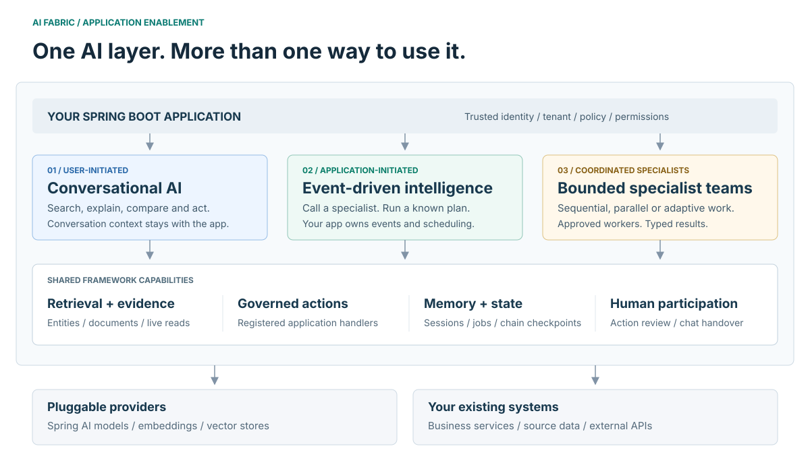
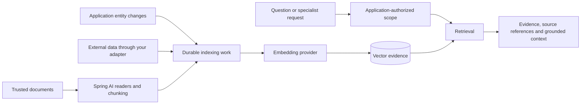
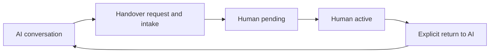

<p align="center">
  <a href="https://ai-fabric.dev">
    
  </a>
</p>

<h1 align="center">AI Fabric Framework</h1>

<p align="center"><strong>AI enablement for Java and Spring Boot. More than a chatbot.</strong></p>

<p align="center">
  Build conversations, event-driven intelligence and bounded specialist teams around your existing<br>
  data and services. Your application keeps control of identity, policy, business state and execution.
</p>

<p align="center">
  <a href="https://github.com/Loom-AI-Labs/ai-fabric-framework/actions/workflows/framework-verify.yml"></a>
  <a href="https://central.sonatype.com/artifact/io.github.loom-ai-labs/ai-fabric-bom"></a>
  
  
  <a href="LICENSE"></a>
</p>

<p align="center">
  <a href="#quickstart"><strong>Quickstart</strong></a> &middot;
  <a href="#four-ways-to-build"><strong>Capabilities</strong></a> &middot;
  <a href="#explore-the-demos"><strong>Live Demos</strong></a> &middot;
  <a href="docs/getting-started/README.md"><strong>Documentation</strong></a> &middot;
  <a href="https://ai-fabric.dev/course"><strong>Course</strong></a>
</p>



## The Idea

Your application already knows who the user is, what they may access, which records are current,
and how a business operation should execute. AI should use those capabilities, not replace them.

AI Fabric adds a modular intelligence layer: understand a request, retrieve authorized evidence,
consult live services, coordinate specialists, and propose or execute permitted application actions.
Use it behind a chat interface, call it from Java, or invoke it from an application-owned event handler.

> **The model interprets, reasons and proposes. Your application owns authority and side effects.**

Built on Spring AI for model integration and document ETL, with opinionated contracts for application
data, governed execution, specialist composition and human participation. Install only what you need;
neither a vector database nor a chat interface is required for every use case.

## Four Ways To Build

### 1. Conversations That Use Your Application

**"Compare these options, explain the policy, then help me take the next step."**

Combine semantic search, grounded answers, live READ actions, attachments, conversation memory and
confirmed application actions in one interaction. Registered actions are Java handlers or reviewed
connector-backed operations, not arbitrary model-generated HTTP requests.

Explore [AI Shopping](https://ai-fabric.dev/demos/ai-shopping-experience),
[Account Resolver](https://ai-fabric.dev/demos/ai-fabric-account-resolver), and the
[governed-action guide](docs/getting-started/05-first-governed-action.md).

### 2. Intelligence Without A Chat Screen

**"When new account events arrive, analyze risk and return a typed assessment."**

Call an exact-version specialist from an application service, an event handler or a scheduled job.
Use typed inputs and outputs, scoped READ actions, optional retrieval, and asynchronous execution.
The host owns the trigger, broker or scheduler and decides what to do with the result.

```java
SpecialistClient<AccountRequest, AccountAssessment> client = specialistClientFactory.bind(
    SpecialistId.of("account-resolver", "1"),
    AccountRequest.class,
    AccountAssessment.class
);

ExecutionHandle handle = client.submit(new SpecialistInvocation<>(
    request, trustedEventContext, null, null, "account-event:" + eventId
));
```

This illustrates a registered specialist and application-defined DTOs; trusted context and the
idempotency key come from the backend, not the event payload or model.
See [Behavior Signals](https://ai-fabric.dev/demos/ai-fabric-behavior-signals) and the
[execution API](ai-infrastructure-module/ai-fabric-execution/README.md#typed-asynchronous-and-event-calls).

### 3. Fixed Sequential And Parallel Plans

**"Always inspect the account, then assess its options."**
Or: **"Check service health and recent changes independently, then combine the findings."**

Declare the steps in Java, use typed input mappers, and aggregate approved specialist results.
Choose a fixed sequence when dependencies are known and bounded parallel branches when work is
independent. A model does not have to rediscover your workflow on every request.

See [fixed sequential plans](ai-infrastructure-module/ai-fabric-execution/README.md#fixed-sequential-plans),
[bounded parallel plans](docs/Framework-Dev-Guides/application-patterns/BOUNDED_READ_ONLY_PARALLEL_PLANS.md),
and the [standalone execution consumer](examples/agentic-execution-consumer/README.md).

### 4. Adaptive Multi-Specialist Teams

**"Investigate this incident. Consult the specialists needed for this question."**

A manager chooses from an application-approved catalogue: answer directly, clarify, consult one
worker, consult independent workers in parallel, or adapt after a result. Define the team in Java
or a versioned `ai.fabric/v1` YAML manifest. Both paths use the same execution runtime.

Workers remain bounded, read-only leaves. The manager receives approved result projections, not
unrestricted tools, credentials or recursive access to other agents.

Try [Incident Investigation](https://ai-fabric.dev/demos/ai-fabric-incident-investigation) or read the
[multi-specialist chain guide](docs/Framework-Dev-Guides/application-patterns/BOUNDED_MULTI_SPECIALIST_CHAINS.md).

**Choose deliberately:** one specialist for one known job; a fixed plan for known steps; an adaptive
chain when the next specialist genuinely depends on the question or earlier evidence. Durable jobs,
JDBC chains and review tasks require their configured stores; the fixed-plan coordinator's state is
ephemeral, not a restartable general-purpose workflow engine.

## Keep Knowledge Connected To Reality

Answers are only as useful as their evidence. AI Fabric connects application records, external
data and trusted documents to a shared indexing and retrieval lifecycle.



- **Application data:** `@AICapable` and `@AIProcess` connect entity create/update/delete operations
  to indexing. The source transaction and its projected queue work commit together.
- **External systems:** use the data-sync and retrieval-connector modules with application-owned
  credentials and source bindings. A READ action can also fetch live facts without indexing them.
- **Documents:** prepare trusted resources with Spring AI readers and transformers, submit canonical
  chunk work, inspect work status, and delete exact manifest identities.
- **Evidence:** expose retrieved records, scores and source references so users and tests can inspect
  what supported an answer. Queue acceptance is not proof that indexing is complete.

Your app owns source storage, source authorization and document version activation/replacement.
AI Fabric provides the preparation, indexing and retrieval primitives; it is not a hosted file store
or a turnkey document-management system. Reader formats depend on the adapters you configure;
the [Document Workbench](examples/real-apps/document-ingestion-workbench/README.md) proves text and JSON.

See [entity indexing](docs/getting-started/03-first-semantic-search.md),
[document indexing](docs/Framework-Dev-Guides/retrieval-vectorization/DOCUMENT_INDEXING_0_8_MIGRATION_GUIDE.md),
and [live synchronization](examples/real-apps/ai-fabric-live-data-sync/README.md).

## People Stay In The Loop

Human involvement has two different meanings. AI Fabric supports both without conflating them.

**Review an action.** Create a governed proposal and route it to an authorized reviewer. Durable
review supports policy-bound approval, rejection, correction, requests for information and
escalation. An approval rechecks the linked action's current authority before execution.

**Take over a conversation.** A user request, button or model-selected action can begin a human
handover. Typed intake can require contact details and consent. While human authority is pending
or active, the AI cannot quietly continue responding; return to AI is an explicit transition.



The framework supplies state and authorization contracts. Your application or integration supplies
the operator UI, authentication and delivery adapter; the framework does not require LoomAI Desk.
See [human conversation handover](docs/Framework-Dev-Guides/application-patterns/CONVERSATION_CONTROL_AND_HUMAN_HANDOVER.md),
[durable action review](docs/Framework-Dev-Guides/application-patterns/DURABLE_HUMAN_REVIEW.md),
or [try the side-by-side demo](https://ai-fabric.dev/demos/ai-fabric-conversation-handover).

## Quickstart

For an existing **Java 21 / Spring Boot 4.1.x** application with Maven 3.9+.
The dependency example targets **0.8.42**, available on Maven Central under `io.github.loom-ai-labs`.
No custom Maven repository is required. Source builds use the POM versions in your checkout.

### 1. Choose Your Modules

Import the BOM, then add the capabilities you use. This example enables indexing, grounded
conversations, session state, OpenAI through Spring AI, and a local Lucene vector store.

```xml
<properties>
  <ai-fabric.version>0.8.42</ai-fabric.version>
</properties>

<dependencyManagement>
  <dependencies>
    <dependency>
      <groupId>io.github.loom-ai-labs</groupId>
      <artifactId>ai-fabric-bom</artifactId>
      <version>${ai-fabric.version}</version>
      <type>pom</type>
      <scope>import</scope>
    </dependency>
  </dependencies>
</dependencyManagement>

<dependencies>
  <dependency>
    <groupId>io.github.loom-ai-labs</groupId>
    <artifactId>ai-fabric-starter</artifactId>
  </dependency>
  <dependency>
    <groupId>io.github.loom-ai-labs</groupId>
    <artifactId>ai-fabric-rag</artifactId>
  </dependency>
  <dependency>
    <groupId>io.github.loom-ai-labs</groupId>
    <artifactId>ai-fabric-chat-session</artifactId>
  </dependency>
  <dependency>
    <groupId>io.github.loom-ai-labs</groupId>
    <artifactId>ai-fabric-provider-spring-ai</artifactId>
  </dependency>
  <dependency>
    <groupId>io.github.loom-ai-labs</groupId>
    <artifactId>ai-fabric-vector-lucene</artifactId>
  </dependency>
</dependencies>
```

### 2. Enable AI Fabric

```java
import ai.fabric.annotation.EnableAIInfrastructure;
import org.springframework.boot.SpringApplication;
import org.springframework.boot.autoconfigure.SpringBootApplication;

@SpringBootApplication
@EnableAIInfrastructure
public class Application {
    public static void main(String[] args) {
        SpringApplication.run(Application.class, args);
    }
}
```

### 3. Connect A Model And Vector Store

```yaml
ai:
  enabled: true
  providers:
    llm-provider: openai
    embedding-provider: openai
    openai:
      enabled: ${OPENAI_ENABLED:false}
      api-key: ${OPENAI_API_KEY:}
      model: ${OPENAI_MODEL:gpt-4o-mini}
      embedding-model: text-embedding-3-small
      embedding-dimensions: 512
  vector-db:
    type: lucene
    lucene:
      index-path: ./data/lucene-512
  service:
    features:
      enable-generation: ${OPENAI_ENABLED:false}
      enable-embeddings: ${OPENAI_ENABLED:false}
      enable-search: true
      enable-rag: true
  chat:
    enabled: true
```

```bash
export OPENAI_ENABLED=true
export OPENAI_API_KEY="<your key>"
```

Keep secrets outside source control. Configure your application's datasource and session/indexing
schema before using persistent state. See [installation](docs/getting-started/02-installation.md)
and [chat sessions](docs/getting-started/06-chat-session-memory.md).

### 4. Connect Your Data Lifecycle

Declare what is searchable, then annotate your existing public transactional write boundary:

```java
@Entity
@AICapable(entityType = "support-article")
public class SupportArticle {
    @Id
    @AIIdentity
    private String id;

    @AISearchable(priority = 100, required = true)
    private String title;

    @AISearchable(maxLength = 8000, priority = 80, required = true)
    private String answer;
}
```

```java
@Transactional
@AIProcess(operation = AIProcessOperation.UPDATE)
public SupportArticle update(SupportArticle article) {
    return repository.saveAndFlush(article);
}
```

The [complete semantic-search guide](docs/getting-started/03-first-semantic-search.md) includes imports,
create/update/delete behavior and the programmatic gateway for paths that cannot use Spring AOP.

### 5. Use The Same Pipeline From Your App

```java
OrchestrationResult result = orchestrator.orchestrate(
    "What is our delivery policy, and can you help with my order?",
    trustedContext
);
```

Here `orchestrator` is `RAGOrchestrator`; `trustedContext` is the application's server-built
`OrchestrationContext`. Derive user, tenant, permissions and allowed capabilities from authenticated
backend state, never from arbitrary browser JSON. Register your own actions to enable operations
such as order lookup; a prompt alone does not add an integration.

Continue with [first RAG chat](docs/getting-started/04-first-rag-chat.md),
[first governed action](docs/getting-started/05-first-governed-action.md), or the complete
[`chat-capabilities-demo`](examples/real-apps/chat-capabilities-demo/README.md).

## Pick The Capabilities You Need

| Capability | Modules and extension points |
| --- | --- |
| Entity indexing and live synchronization | `ai-fabric-indexing`, `ai-fabric-data-sync`, annotations or the public indexing gateway |
| Grounded retrieval and existing search systems | `ai-fabric-rag`, `ai-fabric-retrieval-connector` |
| Application actions and external tools | `@AIAction`, `ai-fabric-actions-connector`, HTTP/MCP bindings; optional database-backed action registry |
| Conversation history, confirmations and human handover | `ai-fabric-chat-session` and application-owned policy/operator integration |
| Specialists, fixed plans and adaptive chains | Optional `ai-fabric-execution`, Java definitions or versioned specialist/chain manifests |
| Durable human review | `ai-fabric-execution`, review policies, reviewer authorization and dispatch adapters |
| Behavior insights and structured UI composition | `ai-fabric-behavior` and application-approved component catalogues |
| Privacy and governance | `ai-fabric-pii`, optional `ai-fabric-governance` |
| Existing-data backfill | `ai-fabric-migration-core` |
| Prompt and mode defaults | Default, commerce and support curated modules, with application overlays |

**Model integration:** Spring AI-backed providers, purpose-specific routing and optional local
ONNX embeddings. **Vector providers:** Lucene, memory, Pinecone, Qdrant, Weaviate and Milvus.
Providers have different filter and lifecycle capabilities; select and test the ones your boundaries require.

The convenience `ai-fabric-starter` includes core, PII and indexing, not every optional capability.
See the [module decision tree](docs/llm-context/AI_FABRIC_MODULE_DECISION_TREE.md),
[BOM](ai-infrastructure-module/pom.xml), and
[curated prompt guide](docs/Framework-Dev-Guides/runtime-modes-prompts/PROMPT_MANAGEMENT_CURATED_MODULES_GUIDE.md).

## Explore The Demos

Every example below links to framework-consuming application source. The website is a companion UI,
not a requirement for using AI Fabric. Check each demo's provider posture: deterministic smoke mode
is useful for local verification, but it is not evidence of live LLM behavior.

| Try it | What to explore | Source |
| --- | --- | --- |
| [AI Shopping](https://ai-fabric.dev/demos/ai-shopping-experience) | Product and policy evidence, attachments, memory, cart actions and checkout confirmation | [Chat capabilities](examples/real-apps/chat-capabilities-demo/README.md) |
| [Account Resolver](https://ai-fabric.dev/demos/ai-fabric-account-resolver) | Live profile reads, policy reasoning and governed remedies | [Account resolver](examples/real-apps/ai-fabric-account-resolver/README.md) |
| [Behavior Signals](https://ai-fabric.dev/demos/ai-fabric-behavior-signals) | Application and scheduled analysis, churn insights and allowlisted UI composition | [Behavior signals](examples/real-apps/behavior-churn-signals/README.md) |
| [Incident Investigation](https://ai-fabric.dev/demos/ai-fabric-incident-investigation) | Adaptive specialists, live READ actions, runbook RAG and parallel evidence gathering | [Investigation room](examples/real-apps/incident-investigation-room/README.md) |
| [Agentic Action Resolver](https://ai-fabric.dev/demos/ai-fabric-agentic-action-resolver) | Specialist composition, governed receipts and human review | [Action resolver](examples/real-apps/agentic-ai-action-resolver/README.md) |
| [Human Handover](https://ai-fabric.dev/demos/ai-fabric-conversation-handover) | Ask for a person, complete intake, reply as the operator and return to AI | [Handover demo](examples/real-apps/conversation-handover-demo/README.md) |
| [Document Knowledge](https://ai-fabric.dev/demos/ai-fabric-document-knowledge-operations) | Preview, index, retrieve, replace and delete documents with actual work status | [Document workbench](examples/real-apps/document-ingestion-workbench/README.md) |
| [Live Data Sync](https://ai-fabric.dev/demos/ai-fabric-live-data-sync) | Change application data and inspect synchronized vector evidence | [Live data sync](examples/real-apps/ai-fabric-live-data-sync/README.md) |
| [Tenant Guard](https://ai-fabric.dev/demos/ai-fabric-tenant-guard) | Tenant-scoped retrieval, role visibility and governed writes | [Tenant knowledge portal](examples/real-apps/tenant-knowledge-portal/README.md) |
| [Privacy Shield](https://ai-fabric.dev/demos/ai-fabric-privacy-shield) | PII detection, redacted persistence and sanitized retrieval | [Privacy-first support](examples/real-apps/privacy-first-customer-facing-support/README.md) |
| [MCP Operations](https://ai-fabric.dev/demos/ai-fabric-mcp-operations) | Authenticated remote tools, confirmed writes and replay-safe receipts | [MCP assistant](examples/real-apps/mcp-operations-assistant/README.md) |
| [Deployment Knowledge](https://ai-fabric.dev/demos/ai-fabric-deployment-knowledge-guard) | Tenant/deployment-scoped evidence, citations and specialist outputs | [Knowledge guard](examples/real-apps/deployment-knowledge-guard/README.md) |

More examples: [real-app capability matrix](examples/real-apps/REAL_APP_CAPABILITIES.md).

## Clear Boundaries, Visible Outcomes

- **Your app owns identity and business data.** The vector index is derived evidence, not a replacement
  for your database. Models do not supply trusted tenant IDs, scopes or hidden resource targets.
- **Actions use registered execution paths.** Authorization, required execution fields, preflight and
  the configured confirmation/review policy still apply at execution time.
- **LLM decisions stay LLM-driven.** Guide semantic choices with prompts, schemas and curated modes;
  keep uncertainty visible. Recovery must follow the configured policy, not silently invent success.
- **Evidence remains inspectable.** Results expose relevant evidence, structured outcomes and
  diagnostics so apps can distinguish an answer, clarification, policy denial or provider failure.
- **The framework is not a managed platform.** Your app owns endpoints, UI, source storage, external
  integration credentials and deployment. AI Fabric supplies reusable Java/Spring capabilities.

See [public architecture](docs/architecture/AI_FABRIC_PUBLIC_ARCHITECTURE.md) and
[security and access policy](docs/getting-started/10-security-access-policy.md).

## Learn And Build

- [Getting started](docs/getting-started/README.md): choose a minimal integration path.
- [Interactive course](https://ai-fabric.dev/course): lessons and real-app walkthroughs.
- [Specialist manifests](docs/Framework-Dev-Guides/application-patterns/SPECIALIST_MANIFEST_AUTHORING_GUIDE.md): schemas, prompts and exact-version definitions.
- [Coding-assistant context](docs/llm-context/README.md): capability map, module choices, rules and recipes.
- [Production checklist](docs/getting-started/13-production-checklist.md): application readiness checks.
- [Release history](https://github.com/Loom-AI-Labs/ai-fabric-framework/releases) and [versioned notes](docs/release-notes): review behavior changes before upgrading; `0.x` releases may require migration.

### Build From Source

```bash
mvn -B -V --no-transfer-progress -f ai-infrastructure-module/pom.xml clean verify

mvn -B -V --no-transfer-progress -f ai-infrastructure-module/pom.xml install
mvn -B -V --no-transfer-progress -f examples/real-apps/pom.xml package
```

Verification is layered: deterministic unit/contract tests, no-key smoke profiles, Docker/Testcontainers
integration tests, and explicitly keyed real-provider checks. A passing smoke run does not substitute
for a real-provider release check. See [testing](docs/getting-started/11-testing-and-verification.md)
and the [release safety checklist](docs/Framework-Dev-Guides/testing-verification/RELEASE_SAFETY_CHECKLIST.md).

<details>
<summary><strong>Repository map</strong></summary>

```text
ai-infrastructure-module/           Framework, providers, vector adapters and integration suites
examples/minimal-spring-boot/        Small Spring Boot consumer
examples/agentic-execution-consumer/ Public execution API and composition proof
examples/real-apps/                  Runnable, product-shaped examples
docs/getting-started/                Developer onboarding
docs/Framework-Dev-Guides/            Architecture and integration contracts
docs/llm-context/                    Coding-assistant guidance
docs/course/                        Course source and labs
docs/release-notes/                  Release behavior and migration notes
```

</details>

## Community

Created and maintained by **[Mahmoud Elgammal](https://www.linkedin.com/in/engmahmoudalgammal/)**
at [Loom AI Labs](https://github.com/Loom-AI-Labs).

[Contributing](CONTRIBUTING.md) &middot; [Code of conduct](CODE_OF_CONDUCT.md) &middot;
[Security](SECURITY.md) &middot; [Issues](https://github.com/Loom-AI-Labs/ai-fabric-framework/issues) &middot;
[Discord](https://discord.gg/cBpR7JQuY) &middot; [Website](https://ai-fabric.dev)

Licensed under [Apache 2.0](LICENSE).
